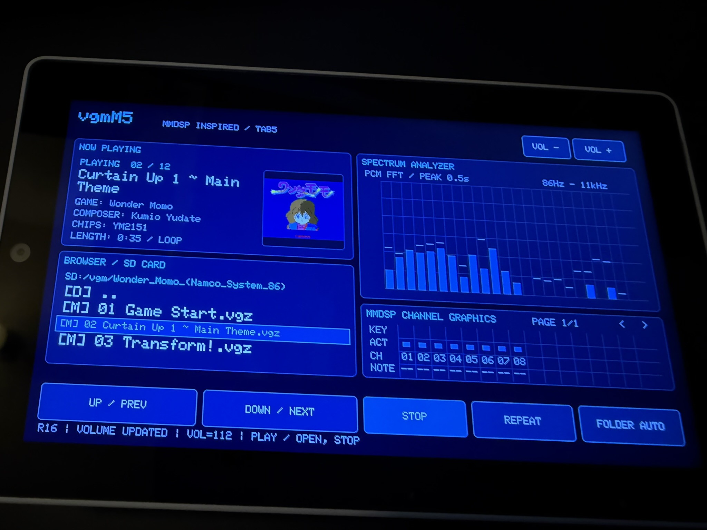

# vgmM5
vgm and mdx player for M5Stack

(English version follows below)

---

## 日本語版 (Japanese)

### 概要
vgmM5 は M5Stackシリーズで動作するVGM/VGZおよびMDX(MXDRV)ファイルプレイヤーです。
🎥 **動作風景 (Demonstration):** [https://x.com/layer812/status/2065461081305489671](https://x.com/layer812/status/2065461081305489671)

#### 対応デバイスと機能 (Supported Devices & Features)
| 機能 (Features) \ デバイス (Device) | M5Stack AtomS3R (Echo) | M5Stack Cardputer | M5Stack CoreS3 | + [Module Audio](https://docs.m5stack.com/ja/module/Module-Audio) | [M5 TAB5](https://docs.m5stack.com/ja/core/Tab5) |
| :--- | :---: | :---: | :---: | :---: | :---: |
| **ステータス (Status)** | ✔️ 対応済 | [✔️ R6公開版](cardputer/README.md) | [✔️ R6安定版](cores3/README.md) | [✔️ R6安定版](cores3/README.md) | [✔️ R67 正式版](tab5/README.md) |
| **VGM/VGZ 再生** | ✔️ | ✔️ | ✔️ | ✔️ | ✔️ |
| **MDX 再生** | ✔️ | ✔️ | ✔️ | ✔️ | ✔️ |
| **内蔵フラッシュ (USB Drive)** | ✔️ | - | - | - | - |
| **MicroSD** | - | ✔️ | ✔️ | ✔️ | ✔️ |
| **オンラインモード** | - | ✔️ | - | - | - |
| **キーボード操作** | - | ✔️ | - | - | - |

#### 対応音源チップ (Supported Sound Chips)
| チップ名 (Chip) | ステータス (Status) |
| :--- | :--- |
| **YM2612 (OPN2)** | ✔️ 対応済 (Supported) |
| **YM3812 (OPL2)** | ✔️ 対応済 (Supported) |
| **SN76489 (PSG)** | ✔️ 対応済 (Supported) |
| **AY-3-8910 (SSG)** | ✔️ 対応済 (Supported) |
| **YM2203 (OPN)** | ✔️ 対応済 (Supported) |
| **YM2608 (OPNA)** | ✔️ 対応済 (Supported |
| **YM2610 (OPNB)** | ✔️ 対応済 (Supported) |
| **YM2151 (OPM)** | ✔️ 対応済 (Supported) |
| **YM2413 (OPLL)** | ✔️ 対応済 (Supported) |
| **SegaPCM** | ✔️ 対応済 (Supported) |
| **K051649 (SCC1)** | ✔️ 対応済 (Supported) |
| **MSM6258** | ✔️ 対応済 (Supported) |
| **OKIM6295** | ✔️ 対応済 (Supported) |
| **Namco C140** | ✔️ 対応済 (Supported |
| **Namco C352** | ✔️ 対応済 (Supported) |

※ 従来のv0.98系に加え、Cardputer R6・CoreS3 R6・Tab5の更新版ソースを公開しています。
※ ステータスが「対応済」となっていても、もし再生時に音がおかしい・違和感があると感じた場合は、曲名とおかしい点を優しく申告していただければ対応いたします！

#### M5Stack Cardputer版（2026年10月26日 更新）
新しいM5Unified 0.2.28／M5GFX 0.2.35に対応し、YM2151の発音・位相など音源処理を修正しました。R6のESP32-S3ネイティブビルドと回帰テストはPASSしています。

M5Burnerシェアコード：`rqz95QwaAsM6bN3O`（作者提供）。[Cardputer版の説明](cardputer/README.md)をご覧ください。

#### M5Stack CoreS3版（2026年10月26日 更新）
Module Audio（ES8388）を接続した場合と、接続せず内蔵スピーカーを使用した場合の**両方で実機動作を確認**しました。

**更新内容:** M5Unified 0.2.28／M5GFX 0.2.35への対応、YM2151を中心とした音源処理とPCM演算の修正・改善。

詳細は [CoreS3版の説明](cores3/README.md) をご覧ください。

#### M5Stack Tab5版 R67 正式版（2026年11月4日）

ESP32-P4採用のTab5に対応。VGM/VGZ・MDXのmicroSD再生、タッチ操作、JPEG/PNG/BMPカバー画像表示が利用できます。

**R67の更新:** 実機でプチプチノイズの消失が確認された微弱PCM方式（R66-A）を正式採用しました。激しいノイズが出た2msフェード方式（R66-B）は**不採用**。AY/SCC、C140、C352、MSM6258、FM/PCM音量バランスなどR62〜R65の改善も含みます。M5Unified 0.2.28 / M5GFX 0.2.35に固定。

[正式版ソース（main）](https://github.com/Layer812/vgmM5/tree/main/tab5) / [R67ネイティブビルド](https://github.com/Layer812/vgmM5/actions/runs/41661806444) / [Tab5版の説明・app-only書き込み](tab5/README.md)

**Tab5用M5Burner新シェアコード：`rg69duyAcUQoohOl`（作者提供）。** ただしM5Burner配布BINとGitHubのR67ビルドBINのSHA-256一致は未確認です。

### 特徴
- **オンラインモード**: Wi-Fiに接続することで、VGM/VGZXファイルをダウンロードする手間なく、クラウドのファイルを指定して再生できます。
- **MDX (MXDRV) フォーマット対応**: VGM形式に加えて、X68000で広く使われたMDX形式の再生にも対応しました。
- **VGZ(GZIP圧縮)対応**: 解凍せずにそのまま再生可能。
- **軽量・高速**: M5Stackの限られたリソースに最適化。

### インストール方法（Web Burner / M5 Burner）

#### Web Burner（ブラウザから書き込み）
M5Stack Web Burnerから、それぞれの機種向けファームウェアの書き込みページを開けます。

- **M5Stack CoreS3（R67 初期版）**：[Web Burnerを開く](https://burner.m5stack.com/share/firmware/P8DPPV)
- **M5Stack Tab5**：[Web Burnerを開く](https://burner.m5stack.com/MWUJ4T)
- **M5Stack Cardputer**：[Web Burnerを開く](https://burner.m5stack.com/METQC2)

> **CoreS3のWeb Burner掲載版はR67の初期版です。** 開発中のCoreS3 PR試験版とは区別してください。

#### M5 Burner（シェアコード）
従来のM5 Burnerを使う場合は、以下のシェアコードを利用できます。

- **M5Stack Tab5用 シェアコード:** `rg69duyAcUQoohOl`
- **M5Stack CoreS3用 シェアコード:** `wEBeKwOKFsqAmlsu`（Module Audioあり・なし共通）
- **M5Stack Cardputer用 シェアコード:** `rqz95QwaAsM6bN3O`
- **M5Stack Atom Echo S3R用 シェアコード:** `zoSd8neRRq7ZQFjB`

---

### 操作方法

#### 📺 M5Stack CoreS3
CoreS3版はタッチパネル操作と内蔵スピーカー再生に対応しています。外部 [Module Audio](https://docs.m5stack.com/ja/module/Module-Audio)（ES8388）を接続した場合も同じR6で再生できます。

> [!IMPORTANT]
> **Module-Audio を使用する場合、正常に動作させるためにモジュール内部のDIPスイッチを「B」に切り替えてから接続してください。**

**基本操作 (タッチパネル):**
- **ファイルリストのタップ**: フォルダ移動、ファイル選択・再生
- **画面下部のアイコン**: (左から) ブラウザに戻る / 前の曲 / 再生・停止 / 次の曲
- **再生中サムネイルのタップ**: 上半分で音量アップ、下半分で音量ダウン

#### 💻 M5Stack Cardputer

**[Cardputer R6 ソース・ビルド手順](cardputer/README.md)**（ESP32-S3ネイティブビルドPASS。オンラインDBを同梱しない場合はローカル再生用ビルド）
Cardputer版はMicroSDカード内のファイル再生に加え、オンラインモードでの再生に対応しています。

**基本操作:**
- **上下 / 方向キー**: ファイルや項目の選択
- **Spaceキー**: 選択した曲の再生 / 停止
- **= キー**: 音量アップ
- **- キー**: 音量ダウン

**オンラインモードの操作:**
- Online/Local: オンラインモードとローカルモード（SDカード）を切り替えます。
- オンラインモードでは、アルバムや曲のリストを読み込み、選択するだけでジュークボックスのように自動で再生が始まります。

#### 🎧 M5Stack Atom Echo S3R
AtomS3Rは画面表示を持たず、メインボタンで操作します。起動時は無音状態で待機します。
- **1クリック**: 再生 / 停止
- **ダブルクリック**: 次の曲
- **トリプルクリック**: 前の曲
- **起動中にボタン長押し**: USBドライブモードに入り、PCから直接ファイルを追加できます。

---

## English Version

### Overview
vgmM5 is a VGM/VGZ and MDX (X68000) file player designed specifically for the M5Stack series.
🎥 **Demonstration:** [https://x.com/layer812/status/2065461081305489671](https://x.com/layer812/status/2065461081305489671)

| Features \ Device | M5Stack AtomS3R (Echo) | M5Stack Cardputer | M5Stack CoreS3 | + [Module Audio](https://docs.m5stack.com/ja/module/Module-Audio) | [M5 TAB5](https://docs.m5stack.com/ja/core/Tab5) |
| :--- | :---: | :---: | :---: | :---: | :---: |
| **Status** | ✔️ Supported | [✔️ R6 Published](cardputer/README.md) | [✔️ R6 Stable](cores3/README.md) | [✔️ R6 Stable](cores3/README.md) | [✔️ R67 Official](tab5/README.md) |
| **VGM/VGZ Playback** | ✔️ | ✔️ | ✔️ | ✔️ | ✔️ |
| **MDX Playback** | ✔️ | ✔️ | ✔️ | ✔️ | ✔️ |
| **Internal Flash (USB Drive)** | ✔️ | - | - | - | - |
| **MicroSD** | - | ✔️ | ✔️ | ✔️ | ✔️ |
| **Online Mode** | - | ✔️ | - | - | - |
| **Keyboard Control** | - | ✔️ | - | - | - |

#### Supported Sound Chips
*(Please refer to the Supported Sound Chips table in the Japanese section above)*

*Note: Updated Cardputer R6, CoreS3 R6 and Tab5 sources are available alongside the original v0.98 implementation.*
*Even if a chip is listed as "Supported," if you notice any strange sounds or something feels off during playback, please kindly report it (gently) with the song title and the issue, and I will address it!*

#### M5Stack Cardputer edition (updated October 26, 2026)
Updated to M5Unified 0.2.28 and M5GFX 0.2.35, with YM2151 note-on and phase corrections. The R6 native ESP32-S3 build and host regression tests passed.

M5Burner share code: `rqz95QwaAsM6bN3O` (author-supplied). See the [Cardputer documentation](cardputer/README.md).

#### M5Stack CoreS3 edition (updated October 26, 2026)
Verified on real CoreS3 hardware **with and without the external Module Audio (ES8388)**, using the internal speaker when no module is attached.

**What's new:** Support for M5Unified 0.2.28 / M5GFX 0.2.35, plus YM2151 sound engine and PCM arithmetic corrections.

See the [CoreS3 documentation](cores3/README.md).

#### M5Stack Tab5 R67 official edition (November 4, 2026)

Supports ESP32-P4 Tab5 with VGM/VGZ and MDX playback from microSD, touch controls and JPEG/PNG/BMP cover artwork.

**R67:** adopts the physically confirmed R66-A ±1-LSB in-song silent PCM treatment; repeated note clicks disappeared on Tab5. Rejects the R66-B 2ms note fade which caused severe noise. Includes R62–R65 AY/SCC, C140/C352, MSM6258 and FM/PCM gain fixes. M5Unified 0.2.28 / M5GFX 0.2.35 are pinned.

[Source (main)](https://github.com/Layer812/vgmM5/tree/main/tab5) / [verified R67 native build](https://github.com/Layer812/vgmM5/actions/runs/41661806444) / [Tab5 release and app-only flashing notes](tab5/README.md).

**Updated M5Burner Tab5 share code: `rg69duyAcUQoohOl` (author-provided).** The binary served by M5Burner has not yet been SHA-256 matched against the GitHub R67 build.

### Features
- **Online Mode (Jukebox)**: Connect via Wi-Fi to play VGM/VGZ files directly from the cloud without the need to download and save them to a MicroSD card.
- **MDX (X68000) Support**: Added playback support for the MDX format, popular on the Sharp X68000.
- **VGZ (GZIP) Support**: Plays directly without decompression.
- **Lightweight & Fast**: Highly optimized for M5Stack's limited hardware resources.

### Installation (Web Burner / M5 Burner)

#### Web Burner (browser-based flashing)
Open the M5Stack Web Burner firmware page for your device:

- **M5Stack CoreS3 (initial R67 release):** [Open Web Burner](https://burner.m5stack.com/share/firmware/P8DPPV)
- **M5Stack Tab5:** [Open Web Burner](https://burner.m5stack.com/MWUJ4T)
- **M5Stack Cardputer:** [Open Web Burner](https://burner.m5stack.com/METQC2)

> **The CoreS3 firmware published on Web Burner is the initial R67 edition.** It is separate from the experimental CoreS3 pull-request builds.

#### M5 Burner (share codes)
Alternatively, use M5 Burner with the following share codes:

- **M5Stack Tab5 Share Code:** `rg69duyAcUQoohOl`
- **M5Stack CoreS3 Share Code:** `wEBeKwOKFsqAmlsu` (with or without Module Audio)
- **M5Stack Cardputer Share Code:** `rqz95QwaAsM6bN3O`
- **M5Stack Atom Echo S3R Share Code:** `zoSd8neRRq7ZQFjB`
---

### Controls

#### 📺 M5Stack CoreS3
The CoreS3 R6 version supports touch input and the built-in speaker, with optional output via [Module Audio](https://docs.m5stack.com/ja/module/Module-Audio) (ES8388). Both configurations have been hardware-tested.

> [!IMPORTANT]
> **When using the Module-Audio, you must switch its internal DIP switch to "B" before connecting it for proper operation.**

**Basic Controls (Touch Panel):**
- **Tap File List**: Navigate folders, select/play files
- **Tap Bottom Icons**: (From left to right) Back to Browser / Previous Track / Play/Stop / Next Track
- **Tap Thumbnail Image**: Top half for Volume Up, Bottom half for Volume Down

#### 💻 M5Stack Cardputer

**[Cardputer R6 source/build guide](cardputer/README.md)** (offline/native build PASS; online catalog requires separately supplied DB files).
The Cardputer version plays files directly from a MicroSD card and supports streaming via Online Mode.

**Basic Controls:**
- **Up/Down / Arrow Keys**: Select file or item
- **Space Key**: Play/Stop selected track
- **= Key**: Volume Up
- **- Key**: Volume Down

**Online Mode Controls:**
- Online/Local: Toggle between Online Mode and Local Mode (MicroSD).
- In Online Mode, simply browse through albums or tracks and select one to start streaming automatically like a jukebox.

#### 🎧 M5Stack Atom Echo S3R
The AtomS3R version runs headlessly and is controlled via the main screen button. It boots into a silent idle state.
- **1 Click**: Play / Stop
- **Double Click**: Next Track
- **Triple Click**: Previous Track
- **Hold while booting**: Enters USB Drive Mode to add files from your PC.

---

### License
Our original source code, modifications, and the matrix processing sound engine are released under the **MIT License**.

This project utilizes and references the following excellent libraries, code, and assets:
- [mdxtools](https://github.com/vampirefrog/mdxtools) - GPL3.0
- [M5Unified](https://github.com/m5stack/M5Unified) - MIT License
- [MAME](https://www.mamedev.org/) - GPL
- ESP-IDF (FFat / Wear Levelling) - Apache License 2.0
- Puff (zlib decompressor) by Mark Adler - zlib License
- [Misaki Font](https://littlelimit.net/misaki.htm) / Little Limit - Free Font License
- [ymfm](https://github.com/aaronsgiles/ymfm) by Aaron Giles - BSD 3-Clause License